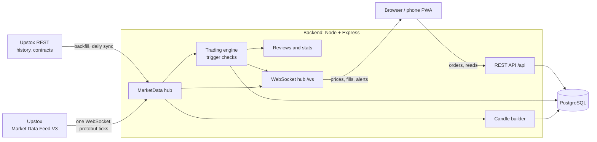

# TradeDojo: project guide

This guide is for learning the project well enough to explain it with confidence, for example in a job interview. It covers what the app does, how it is built, why it is built that way, how to demo it, and the questions people are likely to ask.

Read it with the code open. Every section names the files it talks about, so you can check each claim yourself.

---

## 1. The pitch

### In 30 seconds

> TradeDojo is a mobile-first web app that teaches people to trade MCX gold and silver futures without risking money. Users get virtual points, trade against **real live market prices** streamed from Upstox, and every closed trade gets an automatic **review** that points out bad habits like trading without a stop-loss or revenge trading. There's also a **replay mode** that plays past market days candle by candle so you can practise any time. It's a TypeScript monorepo: an Express + PostgreSQL backend with a WebSocket price pipeline and a simulated trading engine, and a React PWA frontend.

### In 2 minutes (add these)

- **The hard part is the backend.** It holds one WebSocket to Upstox, decodes binary protobuf messages, turns ticks into candles, and on every tick runs a trigger engine that fills pending orders, stop-losses and targets for every user.
- **Money is handled carefully.** All prices and balances are integers in paise, every balance change is written to an append-only ledger, and database constraints stop balances going negative.
- **Real futures complications are handled.** Contracts expire monthly, so the app automatically rolls over to the next contract, closes positions on the old one, and stitches price history across contracts.
- **Learning features.** Coaching flags, what-if analysis ("what if you had held to your target?"), R-multiples, and a stats dashboard with "top 3 habits to fix".
- **Tested.** 74 backend tests run against a real PostgreSQL database, plus frontend unit tests for the indicator maths.

---

## 2. Is it finished?

Be honest about this in interviews; it makes you more credible, not less.

**Done:** all nine milestones of the original spec (backend, market data, trading engine, reviews and stats, frontend shell, trade screen, positions/journal/review/stats screens, replay, admin panel), deployment config for Render, and a README.

**Not yet done or verified:**

| Gap | Why it matters |
|---|---|
| Never run against the real Upstox API | It was built and tested with a mock price provider because the Upstox website wasn't reachable from the build environment. The real connection needs a first run with an Analytics Token. |
| Not deployed yet | No public URL to show. Running it locally with the mock provider works for demos. |
| No CI pipeline | Tests run locally only; there is no GitHub Actions workflow. |
| No email sending | With email verification switched on, the verification link is only logged on the server. |
| Data licensing | Upstox data can't be shown publicly without their written permission (or a licensed vendor). |

If an interviewer asks "what would you do next?", this table is a good answer.

---

## 3. Big picture



Three ideas explain most of the design:

1. **The backend is the single source of truth.** The browser never talks to Upstox. Prices, fills, balances and stop-loss triggering all happen on the server.
2. **One upstream connection, fanned out to many users.** Upstox allows only two feed connections per account, so the server opens one and forwards prices to everyone over its own WebSocket.
3. **Everything that touches money is integer maths plus an audit trail.**

### Why the browser doesn't connect to Upstox directly

This is a very likely interview question. Answers:

- The Upstox token would have to be sent to the browser, where anyone could copy it.
- Upstox allows two feed connections per account; one per user would break at the third user.
- The server must fill orders at prices *it* saw, or users could fake prices.
- Stop-losses must trigger while the user's phone is off.
- Charts, replay and reviews need stored price history.

---

## 4. Tech stack and why

| Layer | Choice | Why |
|---|---|---|
| Language | TypeScript everywhere | One language front to back; types catch mistakes in money and API code. |
| Backend | Node 22, Express 5 | Simple, good at long-lived connections (WebSockets). |
| Validation | zod | Every request body and env var is validated; errors come back as `{ error: { code, message } }`. |
| Database | PostgreSQL via `pg` (raw SQL) | Money needs transactions, row locks and CHECK constraints. Raw SQL keeps those explicit instead of hiding them in an ORM. |
| Realtime | `ws` (server) | Lightweight WebSocket server for pushing prices and fills. |
| Upstox feed | `protobufjs` + the official `.proto` | The feed sends binary protobuf messages. |
| Auth | `jsonwebtoken`, `bcryptjs` | Stateless JWTs, hashed passwords. |
| Frontend | React 19, Vite, react-router | Fast dev server, small build. |
| Charts | TradingView `lightweight-charts` | Purpose-built for candlestick charts and fast. |
| PWA | `vite-plugin-pwa` | Installable app, service worker for the app shell. |
| Tests | Vitest, Supertest, real PostgreSQL | Tests exercise real SQL, constraints and transactions. |

No UI kit: styling is hand-written CSS with CSS variables for themes (`frontend/src/styles.css`).

---

## 5. Repository tour

```
backend/
  migrations/                 SQL schema (001_init.sql is the main one)
  src/
    index.ts                  startup: migrate, settings, admin seed, start services, listen
    runtime.ts                wires market data -> engine -> WebSocket hub -> reviews
    app.ts, routes/*          Express app and REST endpoints
    lib/money.ts              integer money maths (BigInt)
    lib/time.ts               IST date helpers
    services/                 auth, accounts, points ledger, settings
    market/                   everything about prices
      types.ts                PriceProvider interface, Tick, Candle
      upstox/                 real provider: REST client, feed WebSocket, protobuf decoder
      mock/MockProvider.ts    offline random-walk prices
      marketData.ts           the hub: ticks in, quotes/candles/events out
      contracts.ts            contract storage and rollover detection
      candles.ts              storing, stitching and aggregating candles
      marketHours.ts          open/closed, holidays, US daylight-saving close
      backfill.ts             history download with chunking and caching
    engine/
      rules.ts                pure fill/trigger rules (easy to test)
      engine.ts               orders, positions, fills, ledger, rollover
      risk.ts                 risk calculator and position sizing
    reviews/                  coaching flags, what-ifs, review generation, AI coach
    stats/stats.ts            dashboard metrics
    replay/replay.ts          replay sessions
    ws/hub.ts                 the app's own WebSocket server
  test/                       backend tests
frontend/src/
  App.tsx                     routes
  state/                      auth, theme, toasts, mode, market data store
  lib/                        API client, WebSocket client, formatting, indicators
  components/                 chart, order ticket, sheets, glossary...
  pages/                      one file per screen
```

---

## 6. How the important parts work

### 6.1 Live prices: from Upstox to the screen

Files: `backend/src/market/upstox/UpstoxProvider.ts`, `feedDecoder.ts`, `market/marketData.ts`, `ws/hub.ts`, `frontend/src/state/marketStore.ts`.

1. On startup the backend calls Upstox's `/v3/feed/market-data-feed/authorize` endpoint, which returns a one-time WebSocket URL.
2. It connects and subscribes to the current gold and silver contracts in `full` mode (last price, best 5 bids/asks, volume, open interest).
3. Each binary message is decoded with protobuf and normalised into a `Tick` with prices in paise.
4. `MarketData.onTick` ignores ticks for inactive contracts or when the market is closed, then:
   - updates the in-memory quote,
   - feeds the candle builder (1-minute candles),
   - buffers the tick for storage (at most 2 per second per instrument),
   - emits a `quote` event.
5. The engine listens to `quote` events (section 6.4). The hub publishes the quote to clients.
6. **Throttling:** `WsHub` keeps only the latest quote per instrument and a 50 ms pump sends each client at most 4 updates per second per instrument. Slow phones never get flooded.
7. **Reconnects:** exponential backoff (1 s doubling to 60 s with jitter), resubscribe on reconnect, and a watchdog that pings every 30 s and drops a silent connection after 90 s.

The frontend uses a tiny external store with `useSyncExternalStore`, so a tick re-renders only components that read that instrument, not the whole app.

### 6.2 The `PriceProvider` abstraction

File: `backend/src/market/types.ts`.

Every price source implements the same interface (`start`, `getLatest`, `getHistory`, `listContracts`, a `tick` event...). There are three:

- `UpstoxProvider`: the real one.
- `MockProvider`: generates **deterministic** history (seeded random walk, so tests and demos are repeatable) and live ticks with a fake order book.
- `LicensedVendorProvider`: a stub with TODOs, for switching to a licensed data vendor later.

Switching is one env var: `PRICE_PROVIDER=upstox|mock|licensed`. This is the classic **strategy pattern** and a good thing to mention.

### 6.3 Money: integers, a ledger, and constraints

Files: `backend/src/lib/money.ts`, `services/ledger.ts`, `migrations/001_init.sql`.

- **Every price and balance is a `BIGINT` in paise** (1 rupee = 100 paise). No floating point for money.
- Calculations that divide (e.g. gold is priced per 10 g but quantities are in grams) use `BigInt` and round half away from zero in one place (`divRound`).
  - Example: 5 g of gold bought at ₹1,20,000 per 10 g and sold at ₹1,20,500 → `pnl('LONG', 5, 12000000, 12050000, 10)` = 25000 paise = ₹250.
- **The only way a balance changes is `applyLedger()`**, which updates the account row and appends a `points_ledger` row in the same transaction.
- **Database triggers make `fills` and `points_ledger` append-only** (any UPDATE or DELETE raises an error).
- **CHECK constraints** stop `cash_available` or `cash_reserved` from ever going negative; the code turns that error into a friendly "Not enough free points".

Why this matters: if someone asks "how do you know balances are right?", the answer is that every change is recorded and the totals can always be rebuilt from the ledger.

### 6.4 The trading engine

Files: `backend/src/engine/rules.ts` (pure rules), `engine/engine.ts` (database side).

**Orders**
- **Market** orders fill immediately: buy at the best ask, sell at the best bid. If the feed has no order book, it uses last price ± half the configured spread.
- **Limit and stop** entries wait. While waiting they **reserve** their points so free points can't be spent twice.
- No leverage: opening a position reserves its full value.

**The trigger engine** runs on every tick (live) or every candle (replay), in a fixed order:
1. pending entry orders,
2. stop-losses,
3. targets,
4. then trailing stops move and best/worst prices (MFE/MAE) are recorded.

**Two rules worth explaining**
- *Both touched in one candle:* in replay, a single candle can cross both the stop-loss and the target. We can't know which came first, so we assume the stop-loss (the conservative choice) and tell the user in the review.
- *Gaps:* if the market opens beyond your stop (e.g. bad news overnight), the stop fills at the opening price, not the stop price. That's "gap risk", and the review flags it.

**Representing a tick and a candle the same way.** A live tick is treated as a "bar" whose open/high/low/close are all the same price; a replay candle is a bar with a real range. So one set of rules (`evaluateEntry`, `evaluateExit`) serves both live and replay. Good design point to mention.

**Concurrency**
- Live ticks are processed **one at a time per instrument**. If ticks arrive while the engine is busy, they're **merged** into one bar keeping the full high/low range, so no trigger is missed and the queue never grows.
- Every money operation runs in a transaction with `SELECT ... FOR UPDATE` on the account and position rows.
- A real bug that was found and fixed: two simultaneous first requests could both create a replay account. Fixed with a PostgreSQL advisory lock (`pg_advisory_xact_lock`) in `services/accounts.ts`. Good "tell me about a bug" story.

**Safety rules**
- Nothing triggers while the market is closed.
- If no tick arrives for 2 minutes during market hours, prices are "stale": new live orders are paused and nothing triggers on old prices.

### 6.5 Futures contracts and rollover

Files: `market/contractResolver.ts`, `market/contracts.ts`, `market/marketData.ts`, `engine/engine.ts` (`handleRollover`).

MCX gold and silver are **futures**: each contract expires around a date every month or two. The app:

1. downloads the MCX instruments file daily and finds the futures for the configured product (default GOLDM and SILVERM),
2. tracks the near-month contract and switches to the next one **3 days before expiry** (configurable),
3. warns users holding the old contract 2 days before the switch,
4. on rollover day closes those positions at the old contract's last price and cancels its pending orders.

**Stitching history.** Several contracts can have candles for the same minute. One SQL query (`stitchedRows` in `candles.ts`, using `DISTINCT ON`) picks, for each timestamp, the contract that was "near month" at that time. The chart shows a marker where the series switches contracts.

### 6.6 Candles and timeframes

Files: `market/candleBuilder.ts`, `market/candles.ts`.

- Only **1-minute** and **daily** candles are stored. 5m, 15m, 1h and 4h are built on read by aggregation.
- Buckets are aligned to the **09:00 IST** market open, so a 1-hour candle covers 9–10, 10–11, and so on.
- The candle builder turns cumulative daily volume from the feed into per-minute volume.

### 6.7 Replay mode and "no future leaks"

Files: `backend/src/replay/replay.ts`, `frontend/src/pages/Replay.tsx`.

- A session has a clock (`current_ts`) that only moves forward, one candle per step (1x = 1 candle per second, up to 100x, or manual stepping).
- **Everything the user can see is cut off at that clock**: chart candles, prices, market stats and even trade reviews (`asOf` parameter in `getCandles`).
- A partly formed 1-hour candle is built only from 1-minute candles that have fully finished before the clock, so it can't reveal the future.
- New candles are pushed over the WebSocket **only to the session's owner**.
- Replay has its **own balance**, separate from the live account.
- Tests check that no endpoint ever returns data past the clock (`backend/test/replay.test.ts`).

### 6.8 Reviews, coaching flags and stats

Files: `reviews/flags.ts`, `reviews/whatif.ts`, `reviews/review.ts`, `stats/stats.ts`.

When a position fully closes, a `trades` row is created and a review is generated:

- **R-multiple** = profit ÷ the risk you planned (distance to stop × quantity). +2R means you made twice what you risked.
- **MFE / MAE**: best and worst point of the trade.
- **What-ifs**: held to target, held 1 hour / 1 day longer, had no stop. These need prices from after the exit, so they say "pending" and a job fills them in later.
- **Coaching flags** (pure function, every rule tested): no stop-loss, moved stop further away, risked more than 2%, reward smaller than risk, exited a winner early, held a loser past the stop, revenge trade (within 5 minutes of a loss), overtrading, traded against the daily trend (price vs 50-day EMA), entered in the first 5 minutes or last 15 minutes, stopped out by a gap.

**Stats**: equity curve, win rate, average win/loss, profit factor, expectancy, max drawdown, streaks, breakdowns by setup/side/time/confidence, a calendar heatmap, and "top 3 habits to fix" from the last 20 trades. The leaderboard ranks by **return ÷ max drawdown** (risk-adjusted), not raw profit, so reckless trading isn't rewarded.

### 6.9 Auth and users

Files: `services/auth.ts`, `routes/auth.ts`, `lib/http.ts`.

- Passwords hashed with bcrypt. For an unknown email, a dummy hash is still compared so response timing doesn't reveal which emails exist.
- Login returns a JWT. Each user row has a `token_version` inside the JWT; changing the password or disabling the account bumps it, which logs out every existing session.
- The frontend keeps the token in `sessionStorage`, so each browser tab can be logged in as a different user (useful for demos).
- Login and order placement are rate-limited.
- Roles: `user` and `admin`; the first admin is created from environment variables.

### 6.10 Frontend highlights

- Mobile first (360–430 px), bottom tab bar; from 1024 px a sidebar and a three-column trade screen.
- Order ticket with a live **risk calculator** (points at risk, % of account, reward, R:R), a position-size helper, warnings that *warn but don't block*, and a mandatory short trade plan.
- Stop-loss and target lines can be **dragged on the chart** (`components/Chart.tsx` handles pointer events and converts pixels to prices).
- Indicators written from scratch with unit tests (`lib/indicators.ts`).
- PWA: installable; the service worker caches only the app shell, never API responses; the journal is available offline as a read-only copy.

---

## 7. Data model (main tables)

| Table | What it holds |
|---|---|
| `users` | accounts, role, `token_version` |
| `accounts` | one active live and one replay balance per user, per season |
| `points_ledger` | every balance change (append-only) |
| `instruments`, `contracts` | gold/silver config and MCX futures contracts |
| `price_ticks`, `candles` | raw ticks (pruned after 7 days) and 1m/1d candles |
| `orders` | market/limit/stop orders, with reserved points |
| `positions`, `position_events` | open/closed positions and SL/TP edits |
| `fills` | every execution (append-only) |
| `trades`, `trade_reviews`, `trade_notes` | closed round trips, their reviews, user reflections |
| `replay_sessions` | replay clock and status |
| `settings`, `market_holidays`, `drawings`, `backfill_jobs` | config and misc |

Schema: `backend/migrations/001_init.sql`.

---

## 8. Testing

- **Backend: 74 tests** across `auth`, `market`, `engine`, `reviews`, `replay` and `admin`, run against a **real PostgreSQL** database (wiped at the start of every run).
- A **test harness** (`test/engineHarness.ts`) creates a market with a controllable clock and a mock provider you can inject ticks into, so tests can say "at 10:00 the price is X, then 3 minutes pass with no ticks" and check exactly what the engine does.
- Fixtures: a sample MCX instruments file and a protobuf feed message encoded with the official `.proto`.
- **Frontend: 7 tests** for the indicator maths.

Run: `npm test` (needs a local PostgreSQL; see README section 4).

Why a real database instead of mocks: the most important guarantees (constraints, triggers, transactions, row locks) live in PostgreSQL, so mocking it would test nothing that matters.

---

## 9. A 5-minute demo script

Setup: `PRICE_PROVIDER=mock` in `backend/.env`, then `npm run seed:demo` and `npm run dev`. Log in as `demo1@local` (password `demo-pass-123`) in one tab and `admin@local` in another.

1. **Trade screen (phone width):** live prices ticking, switch Gold/Silver, change timeframes, turn on an indicator.
2. **Place a trade:** tap BUY, show the risk calculator, drag the stop-loss line on the chart, pick a setup tag, write a one-line plan, place it.
3. **Positions:** live P&L moving; edit the stop-loss further away and point out the warning.
4. **Close it** and open the **trade review**: R-multiple, best/worst moments, what-ifs, coaching flags.
5. **Stats:** equity curve, "top 3 habits to fix".
6. **Replay:** pick a past day, press play at 20x, show the candles appearing and that you can trade.
7. **Admin tab:** feed health and settings.

While demoing, narrate *why*: "the backend owns the price so users can't fake fills", "stop first if a candle touches both", "the replay never shows a candle before its time".

---

## 10. Likely interview questions (with answers)

**Why not let the browser connect to Upstox?** See section 3.

**How do you avoid floating-point errors with money?** Integer paise in `BIGINT` columns, BigInt for intermediate maths, rounding in one function (section 6.3).

**What happens if two orders hit the same account at the same time?** Each runs in a transaction that locks the account row (`FOR UPDATE`), so they're applied one after the other; CHECK constraints are the final safety net.

**What if ticks arrive faster than you can process them?** Per-instrument queue; ticks that arrive while busy are merged into one bar that keeps the full high/low range, so no stop is skipped (section 6.4).

**How do you make sure replay doesn't cheat?** One cut-off time (`asOf`) applied to every read; higher timeframes built only from completed minutes; tests for it (section 6.7).

**How does it scale?** Today it's designed as **one** backend instance (one Upstox connection, replay timers in memory). To scale: move replay timers and WebSocket fan-out behind something like Redis pub/sub, keep a single "market data" worker that owns the Upstox connection, and run several stateless API/WebSocket servers.

**Why raw SQL and not an ORM?** Money logic depends on transactions, row locks, constraints and a few advanced queries (`DISTINCT ON` stitching); raw SQL keeps those visible and exact.

**What was hard?** Futures rollover and stitching history across contracts; making the same rules work for live ticks and replay candles; keeping replay from leaking future data.

**Tell me about a bug.** The replay-account race (section 6.4): two first requests both tried to create the account and one failed a unique constraint; fixed with an advisory lock.

**What would you do next?** The table in section 2, plus CI, a real end-to-end test with Upstox, and the Azure/Render deployment.

**Security?** Upstox token never leaves the server; bcrypt; JWT with `token_version` revocation; rate limits; zod validation on every input; CSV export guards against spreadsheet formula injection; the service worker never caches API data; the optional AI coach sends only anonymised numbers.

---

## 11. Talking about how it was built

The README says the project was written with Claude Code (an AI coding agent) from your requirements. Interviewers may ask about it. Things that help:

- **Say it plainly.** "I wrote the specification and requirements, and used an AI coding agent to implement them; I reviewed, tested and deployed it."
- **Show ownership by understanding.** The goal of this guide is that you can explain any part, including trade-offs and limitations. Practise explaining sections 6.3, 6.4 and 6.7 out loud without notes.
- **Be ready to go one level deeper.** Pick two or three files (`engine/rules.ts`, `lib/money.ts`, `ws/hub.ts`) and read them line by line until you could rewrite them.
- **Make a change yourself.** Adding a small feature on your own (for example a new coaching flag in `reviews/flags.ts` with a test in `test/reviews.test.ts`) is the fastest way to build real confidence, and gives you a story of your own to tell.

---

## 12. Trading terms cheat sheet

| Term | Meaning |
|---|---|
| Long / short | Buy first and profit if price rises / sell first and profit if it falls |
| Bid / ask | Best price buyers pay (where you sell) / best price sellers accept (where you buy) |
| Spread | Ask minus bid; the cost of a round trip |
| Market / limit / stop order | Fill now / fill at a better price / fill when price breaks a level |
| Stop-loss / target | Automatic exit to cap a loss / take a profit |
| Trailing stop | Stop that follows price at a fixed distance and never moves back |
| R-multiple | Profit ÷ planned risk |
| R:R | Planned reward ÷ planned risk |
| MFE / MAE | Best / worst point of a trade |
| Drawdown | Drop from a peak in account value |
| Profit factor | Total wins ÷ total losses |
| Expectancy | Average profit per trade |
| Futures, expiry, rollover | Contract for a later date; it expires; you move to the next one |
| Open interest | Number of open futures contracts |
| Gap | Market opening far from the previous close |
| ATR, RSI, EMA, VWAP, MACD, Bollinger | Common indicators: average range, momentum, moving average, volume-weighted average price, trend momentum, volatility bands |
| MCX | Multi Commodity Exchange of India |
| GOLDM / SILVERM | MCX gold mini (priced per 10 g) and silver mini (priced per kg) |
